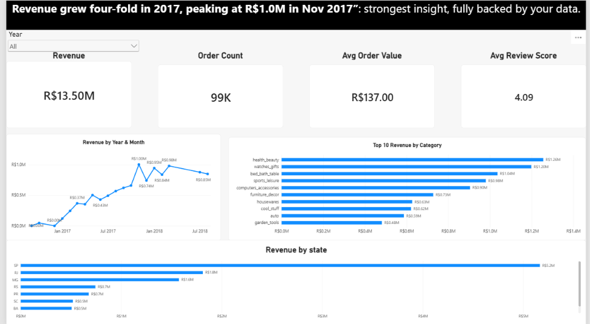
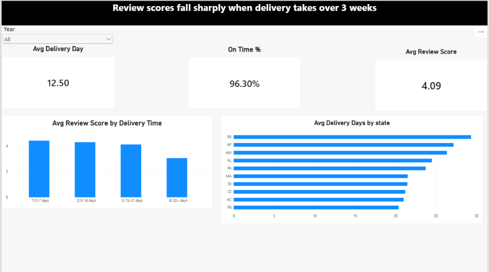
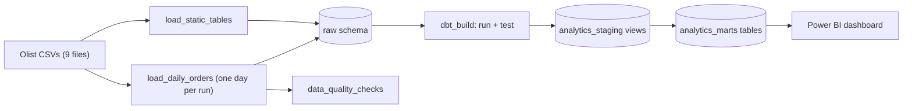

# Olist E-Commerce Data Platform

An end-to-end data pipeline built on the public Olist Brazilian e-commerce dataset. Airflow orchestrates daily loads into Postgres, dbt models the data into a star schema with tests, and Power BI sits on top for reporting. Everything runs locally with one `docker compose` command.

**Stack:** Apache Airflow 2.10 | PostgreSQL 16 | dbt 1.9 | Docker Compose | Python (pandas) | Power BI

## Dashboard

| Sales overview | Delivery and satisfaction |
|---|---|
|  |  |

Headline numbers (canceled orders excluded): R$13.50M revenue, about 99K orders, R$137 average order value, 4.09 average review score, 12.5 days average delivery, 96.3% delivered on or before the estimated date.

## Architecture



Two separate Postgres containers are used on purpose: one holds Airflow's own metadata, the other is the warehouse.

## What the pipeline does

**1. `load_static_tables`** loads the 5 reference tables (customers, sellers, products, geolocation, category translation) with Postgres `COPY`. These are full refreshes: each run drops and recreates the table, so re-running never duplicates rows.

**2. `load_daily_orders`** simulates daily arrival of orders. Each DAG run loads one purchase date for orders, order items, payments and reviews, then runs data quality checks.
- Runs `@daily` with `catchup=True`, so a backfill replays the full history day by day (2016-09-04 to 2018-10-17, about 775 runs).
- Idempotent: every raw row carries a `_purchase_date`, and each run deletes its own date before reinserting. Clearing and re-running any day gives identical counts.
- Empty days (the dataset is sparse in late 2016) load zero rows without failing.
- Retries: 2 with exponential backoff on loads, plus a failure callback that logs the DAG, task and run. The quality task has 0 retries because a deterministic check gives the same answer every time.

**3. `data_quality_checks`** runs after every daily load and fails the run if it finds any of: duplicate `order_id`, null or empty `order_id`, or orphan rows in order items, payments or reviews (children with no parent order for that day).

**4. `dbt_build`** runs `dbt run` then `dbt test` inside Airflow, using dbt installed in its own virtualenv in the Airflow image so it cannot clash with Airflow's dependencies. It is a separate daily DAG on purpose: rebuilding every mart once per daily slice during a 775-day backfill would be wasted work.

## Data model

Raw tables keep every column as `TEXT`, exactly as it arrives. Casting and cleaning happen in dbt, so a bad value never breaks a load (ELT).

| Layer | Schema | Contents |
|---|---|---|
| Raw | `raw` | 9 tables, all TEXT, plus `_purchase_date` on the four daily tables |
| Staging | `analytics_staging` | 9 views: typed, renamed, trimmed, one per raw table |
| Marts | `analytics_marts` | `dim_customers`, `dim_sellers`, `dim_products`, `dim_date`, `fact_orders`, `fact_order_items`, `agg_monthly_sales` |

`fact_orders` has one row per order with item count, item value, freight, payment total, review score, delivery days and days versus the estimated date. `fact_order_items` has one row per item. `agg_monthly_sales` excludes canceled orders.

**dbt tests:** `unique`, `not_null`, `relationships` (every order has a customer, every item has an order, product and seller) and `accepted_values` on order status and review score. Two custom tests fail the build if any order has a negative value or is delivered before it was purchased. The reviews uniqueness test is set to `warn`, because the source data repeats some review IDs.


## Data quality gate in action

To prove the check is a real gate, I inserted an orphan order item into the warehouse. The load tasks stayed green, `data_quality_checks` failed the run, the failure callback logged the alert, and clearing the day let the idempotent reload remove the bad row and pass again.


## Verification

- The full backfill loads **99,441 orders**, matching the source file exactly, with no failed runs across the history.
- A one-month slice (January 2017) was recomputed straight from the CSVs and compared to the raw tables: orders 800, items 955, payments 850, reviews 797, all matching.
- Canceled orders account for the gap between raw order counts and the monthly aggregate, by design.

## Getting started

**Prerequisites:** Docker Desktop (with at least 4 GB of memory available to Docker) and Git.

1. Clone the repo:
   ```
   git clone https://github.com/AHAH000/ecommerce-data-platform.git
   cd ecommerce-data-platform
   ```
2. Download the **Brazilian E-Commerce Public Dataset by Olist** from Kaggle and unzip all 9 CSVs directly into `data/`. The CSVs are gitignored.
3. Create your `.env` from the example (local-only throwaway credentials):
   ```
   cp .env.example .env
   ```
   Keys: `AIRFLOW_ADMIN_USER`, `AIRFLOW_ADMIN_PASSWORD`, `WAREHOUSE_USER`, `WAREHOUSE_PASSWORD`, `WAREHOUSE_DB`.
4. Build and start:
   ```
   docker compose build
   docker compose up airflow-init
   docker compose up -d
   ```
5. Open Airflow at http://localhost:8081 and log in with the admin credentials from your `.env`.
6. Run the DAGs in this order:
   1. Toggle on and trigger `load_static_tables`.
   2. Toggle on `load_daily_orders`. It backfills the full history on its own, one day at a time. Expect roughly 1 to 2 hours.
   3. Trigger `dbt_build` once the backfill finishes.

The warehouse is exposed on `localhost:5433` (database `olist`) so you can connect with DBeaver or Power BI. Ports 8081 and 5433 were chosen to avoid clashing with other local services.

**Check the result:**
```
docker compose exec warehouse psql -U warehouse -d olist -c "select count(*) from raw.orders;"
docker compose exec warehouse psql -U warehouse -d olist -P pager=off -c "select * from analytics_marts.agg_monthly_sales;"
```

**Power BI:** connect to PostgreSQL at `localhost:5433`, database `olist`, and load the tables from `analytics_marts`. Relationships are many-to-one from the facts to the dimensions.

**Optional, run dbt from your machine:** install `dbt-core==1.9.0` and `dbt-postgres==1.9.0`, create a profile named `olist_dbt` pointing at `localhost:5433`, then run `dbt build` inside `dbt_project/olist_dbt`. Use `dbt docs generate` and `dbt docs serve --port 8082` for the docs site.

## Design decisions

- **ELT with an all-TEXT raw layer:** loads never fail on a bad value, and every cleaning rule lives in version-controlled SQL.
- **Idempotent partitions instead of append-only loads:** delete-then-insert per date makes any run safely repeatable, which is what makes backfills and clears safe.
- **Quality checks fail fast and loudly:** transient errors retry with backoff, but a data problem fails immediately instead of retrying the same bad data.
- **dbt as its own DAG:** marts rebuild on a schedule, not once per daily slice.
- **dbt in a separate virtualenv:** avoids dependency conflicts with Airflow.
- **Canceled orders excluded from revenue metrics:** applied the same way in the dbt aggregate and in the Power BI measures, so both agree.

## Insights from the data

- Monthly revenue climbed through 2017 and peaked at about R$1.0M in November 2017 (Black Friday).
- Sao Paulo (SP) is by far the biggest state by revenue, at about R$5.2M of R$13.5M.
- Delivery time drives satisfaction: average review scores sit around 4.1 to 4.3 for deliveries up to 21 days, then fall to about 3.0 beyond 21 days.
- Late 2016 has very few orders, so trend charts start in January 2017.

## Limitations and next steps

- Runs locally with `LocalExecutor`; a production setup would use a managed Airflow and warehouse.
- Daily arrival is simulated by slicing static CSVs by purchase date, not a live source.
- Failure alerts are written to the Airflow logs only. Email or Slack alerts are a natural next step.
- The geolocation table is staged but not yet used in a mart. A seller and customer distance model is a possible extension.
- dbt runs through a `BashOperator`; the Cosmos package would give per-model tasks in the Airflow graph.

## Repo structure

```
dags/                 Airflow DAGs (static load, daily orders, dbt build)
dbt_project/olist_dbt dbt project: staging, marts, tests
docker/               Dockerfile (Airflow + dbt) and the dbt profile used in the containers
docs/                 Screenshots
data/                 Olist CSVs (not committed)
docker-compose.yml    Airflow, Airflow metadata DB, warehouse DB
.env.example          Environment variable template
```

## Credits

Dataset: Brazilian E-Commerce Public Dataset by Olist, published on Kaggle. Check the dataset page for its license terms.
